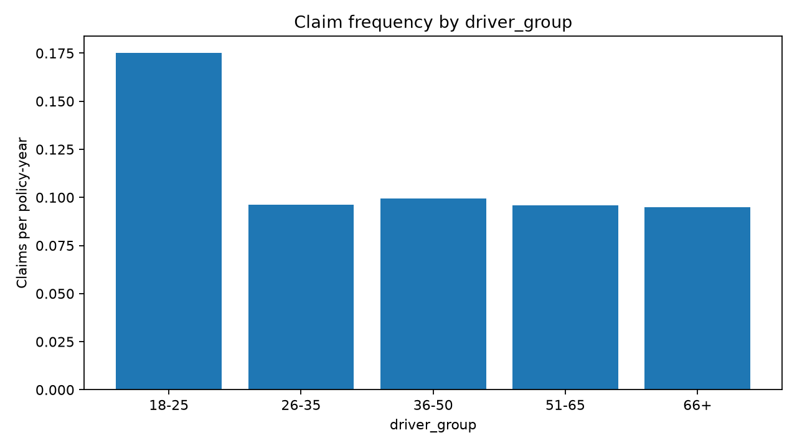
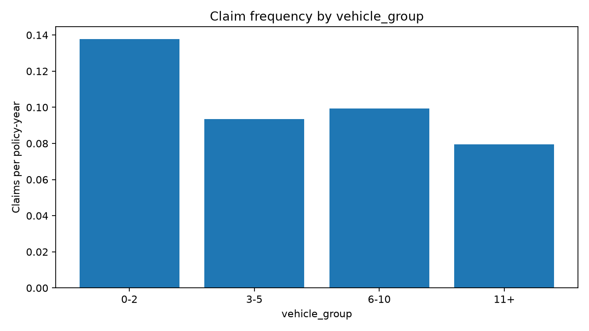
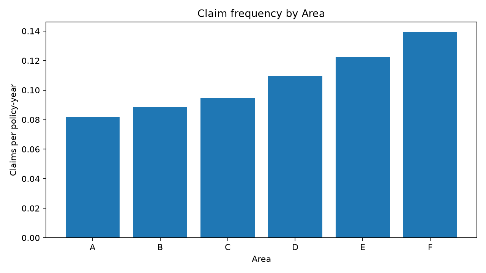

# Insurance Pricing Analytics & Business Requirements Delivery

**An end-to-end motor insurance pricing analytics and business analysis project combining Python, statistical modelling, risk segmentation, requirements engineering and UAT design.**

## Project Overview

This independent project simulates an insurance pricing transformation initiative, bridging actuarial analytics, business requirements and technology delivery.

The objective is to analyse motor insurance claim frequency, identify relevant risk segments, develop an illustrative pricing methodology and translate analytical findings into structured, testable business requirements.

## Key Results

| Metric | Result |
|---|---|
| Insurance policy records analysed | 678,013 |
| Total observed claims | 36,102 |
| Observed claim frequency | 0.1007 claims per exposure-year |
| Baseline test Poisson deviance | 0.617659 |
| Model test Poisson deviance | 0.599858 |
| Relative reduction in test deviance | 2.88% |
| Business requirements documented | 8 |
| User stories designed | 4 |
| UAT test cases designed | 10 |

The Poisson-based frequency model achieved a 2.88% reduction in test Poisson deviance compared with the baseline model. This indicates an improvement on the selected evaluation metric, rather than a 2.88 percentage-point increase in predictive accuracy.

## Data & Methodology

**Data source:** Public French motor third-party liability insurance data (freMTPL2 frequency dataset), retrieved through OpenML.

The project analyses policy exposure, claim counts, driver age, vehicle age and geographic risk characteristics.

**Technical approach:**

- Data preparation and exploratory analysis using Python and pandas.
- Exposure-adjusted claim frequency analysis.
- Poisson-based claim frequency modelling.
- Out-of-sample evaluation against a baseline model.
- Risk segmentation across demographic, vehicle and geographic factors.
- Illustrative pure premium calculations using explicitly stated assumptions.

## Key Analytical Findings

### Driver Age

Drivers aged 18–25 showed an observed claim frequency of approximately 17.51%, compared with 9.62% for drivers aged 26–35.

### Vehicle Age

Vehicles aged 0–2 years showed an observed claim frequency of approximately 13.77%, compared with 7.95% for vehicles aged 11 years or older.

### Geographic Risk

Observed claim frequency varied across geographic categories, from approximately 8.17% in Area A to 13.91% in Area F.

These findings represent descriptive associations and should not be interpreted as independent causal effects or approved commercial rating relativities.

## Business Analysis & Requirements Engineering

The project extends beyond statistical modelling by translating pricing assumptions and analytical outputs into structured business requirements.

The Business Requirements Document covers:

- Claim frequency prediction and rating inputs.
- Approved risk factor handling and pricing logic.
- Illustrative pure premium calculations.
- Data quality and exception handling.
- Model and pricing rule traceability.
- Governance, approval and implementation controls.
- Business acceptance criteria and delivery dependencies.

## User Stories & UAT Design

Developed four user stories and ten UAT test cases to demonstrate how pricing requirements could be translated into implementation-ready specifications.

Testing scenarios address calculation consistency, invalid inputs, boundary conditions, auditability and requirements traceability.

**UAT status:** Test cases have been designed but have not been executed against a production insurance system.

## Project Deliverables

- `day1.py` — Data preparation, exploratory analysis and frequency modelling.
- `requirements.txt` — Python dependencies.
- `outputs/` — Risk segmentation charts, CSV summaries and illustrative pricing outputs.
- `Insurance_Pricing_BRD_and_Case_Study.docx` — Business requirements and project case study.
- `UAT_and_Traceability.xlsx` — User acceptance testing and requirements traceability documentation.

## How to Run

1. Install Python 3.10 or newer with compatible dependencies.
2. Install the required packages:

   `python -m pip install -r requirements.txt`

3. Execute the analysis:

   `python day1.py`

4. Review the generated charts and CSV files in the `outputs/` directory.

The first execution requires an internet connection to retrieve the public dataset.

## Limitations & Future Improvements

- The dataset represents French motor insurance, not an Australian insurance portfolio.
- The project uses an assumed claim severity of €2,000 for illustrative pure premium calculations; no separate severity model has been validated.
- The model is a research prototype, not a production-ready pricing engine.
- Further work would include severity modelling, calibration, regulatory review, sensitivity analysis and broader model validation.
- Business requirements and UAT artefacts represent a simulated delivery scenario rather than an implemented insurer system.

## Project Scope

This is an independent portfolio project using public data. It is not affiliated with CGU, Insurance Australia Group or any insurance provider.

**Skills demonstrated:** Python · pandas · Poisson Regression · Insurance Pricing Analytics · Risk Segmentation · Business Requirements · Rating Logic · User Stories · UAT Design · Requirements Traceability
